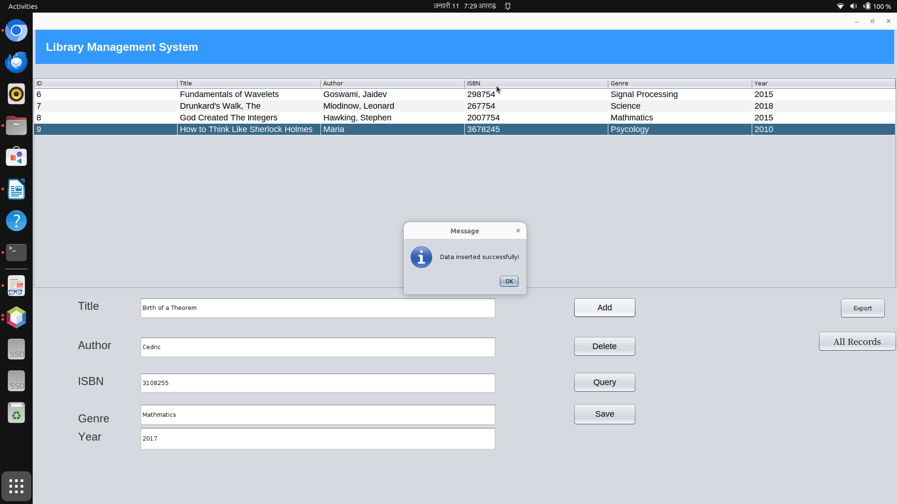

# Library Management System

A Java Swing desktop app for managing a library's book records, backed by a MySQL database.


## Features

- **Login** with the database username and password
- **Add, update and delete** books (title, author, ISBN, genre, year)
- **Search** across title, author, ISBN, genre and year
- **Show all records** in a table, and click a row to load it into the form
- **Export** the records in the table to a CSV file

## Concepts practised

- JDBC with **prepared statements** for every query, so user input cannot change the SQL
- Java Swing forms built with the NetBeans GUI builder (`JFrame`, `JTable`, `JFileChooser`)
- Writing CSV files with `FileWriter`

## Requirements

- Java 22 (the project was built with JDK 22)
- MySQL or MariaDB (for example through XAMPP)
- The MySQL JDBC driver is included in `LibraryManagement/dist/lib`

## Setup

1. Create a database named `libraryManagementSystem`.
2. Import `LibraryManagement/libraryManagementSystem (1).sql`. It creates the `book` table with a few sample books.
3. Run the app:

```bash
cd LibraryManagement/dist
java -jar LibraryManagement.jar
```

4. Log in with your MySQL username and password.

To build from source, open the `LibraryManagement` folder in NetBeans, or run `ant jar`.

## Screenshots

| Add a book | Search | Export |
|---|---|---|
|  |  |  |

| Update | Delete | Exported CSV |
|---|---|---|
|  |  |  |

## Files

```
LibraryManagement/
├── src/LoginJFrame.java     login window
├── src/MainJFrame.java      main window: table, form, search, export
├── libraryManagementSystem (1).sql   database table and sample data
├── dist/                    ready-to-run jar and JDBC driver
└── Screenshots/
```
